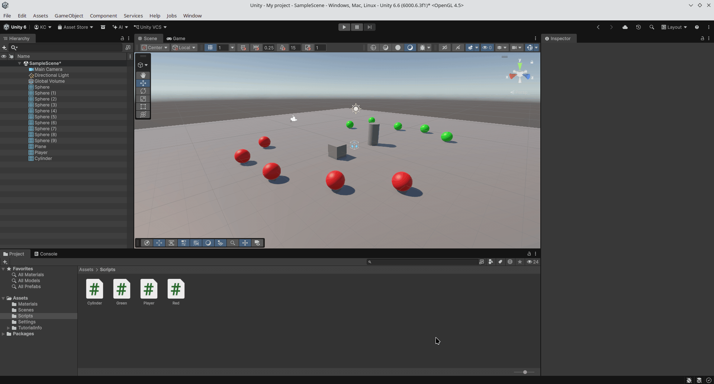
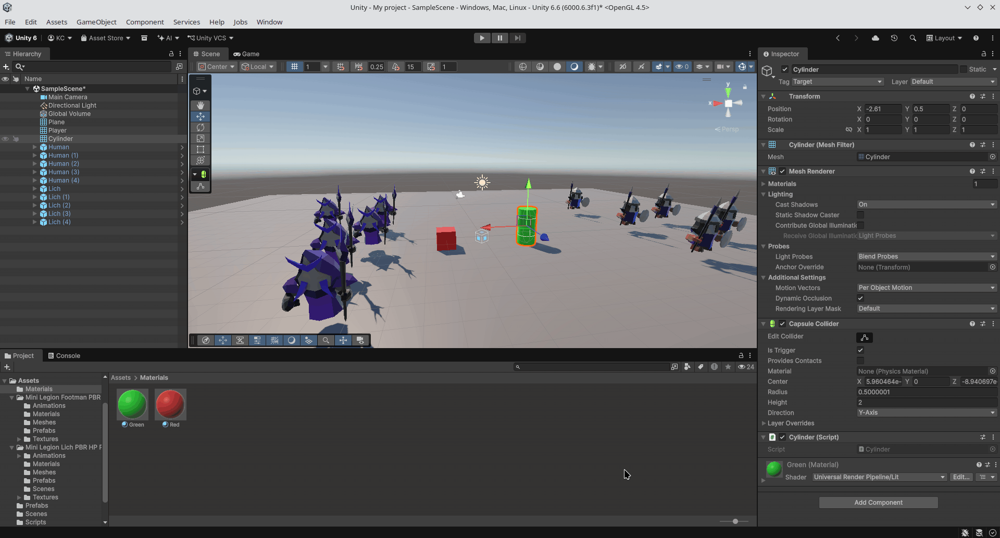
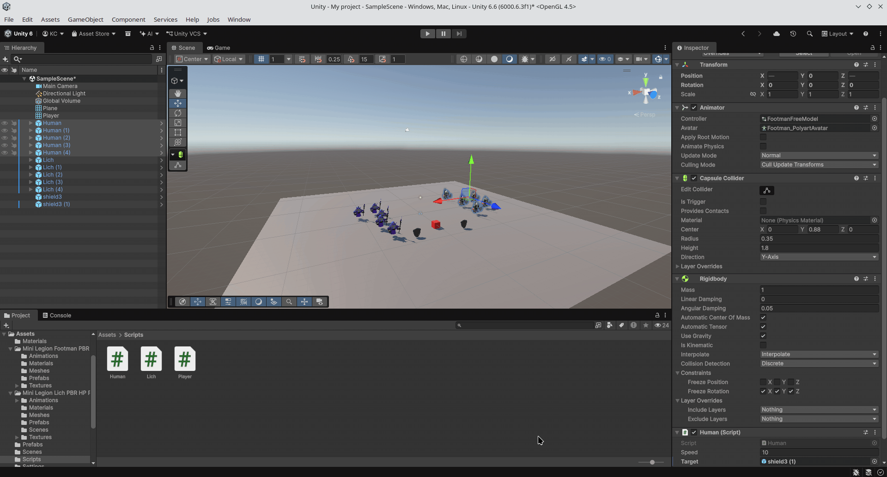
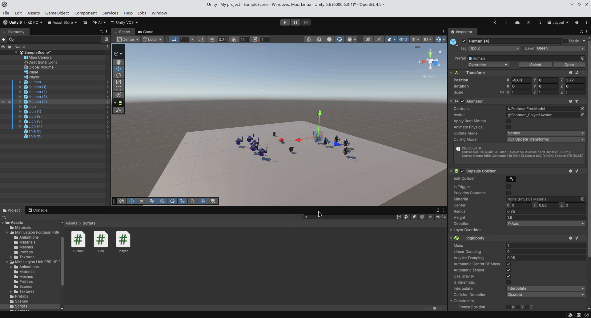
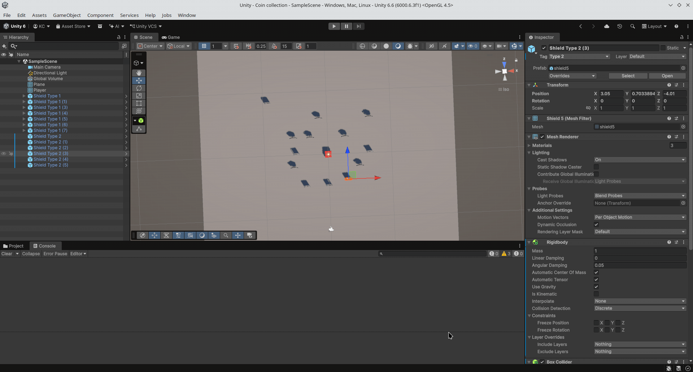
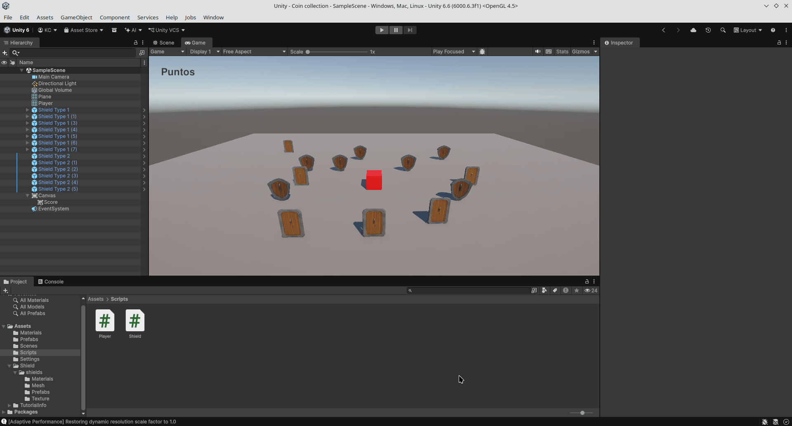
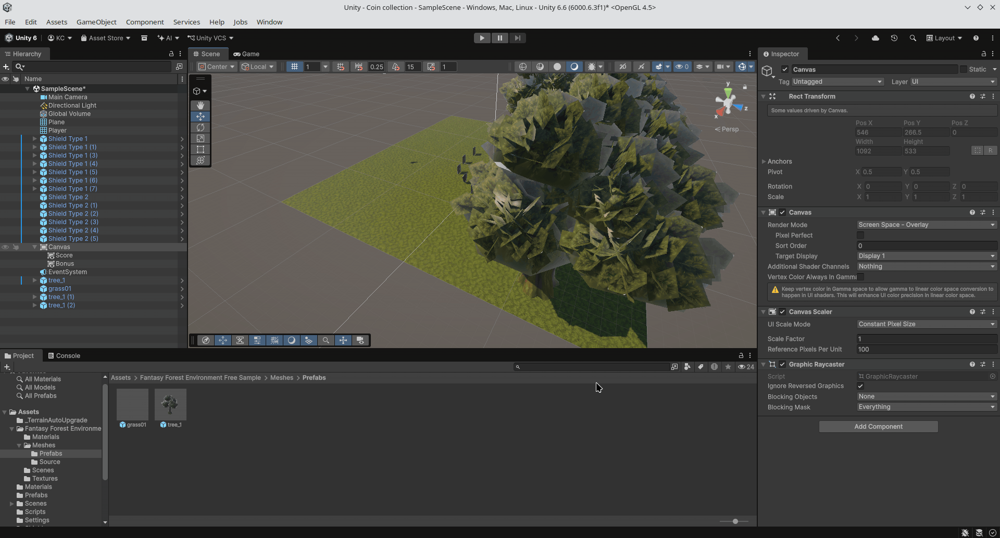
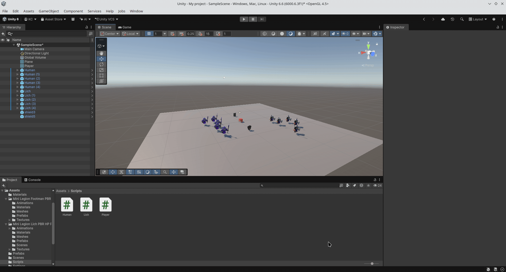

# Práctica 3: Eventos y Delegados

## Ejercicio 1

Se implementó el patrón observador. Como las esferas verders (tipo 2) van
al cilindro, y las esferas rojas (tipo 1) van a una de las esferas verdes al alzar,
parece que todas las esferas van al cilindro. La esfera al azar se elige mediante
FindWithTag.

## Ejercicio 2

Las esferas verdes ahora son humanos y las esferas rojas son liches.

## Ejercicio 3

Descargué un modelo de escudo e implementé las mecánicas descritas en el
ejercicio mediante el patrón observador. Los humanos y los liches tienen
eventos propios. Uno escucha los eventos del otro.

## Ejercicio 4

He descargado otro modelo de escudo del asset store para diferenciarlos mejor.
Los liches se teletransportan y los humanos miran mediante el patrón observador.
El jugador es el que manda el evento.

## Ejercicio 5

He creado dos tipos de escudo casi idénticos, solo cambié el modelo.
Les he asignado un script universal que permite definir la cantidad de
puntos que se obtiene al recolectarlo. En este ejercicio descubrí que
es importante eliminar la suscripción al destruir cualquier objeto que
se suscribe a un cierto evento, ya que si no se hace, puede producir
bugs y comportamientos inesperados, como por ejemplo mensajes duplicados
que no deberían existir.

## Ejercicio 6

He añadido un canvas y un texto legacy. En el código obtengo la referencia a
la etiqueta y cuando el jugador recolecta cualquier escudo, se produce un evento
que el jugador captura y actualiza el contenido del texto.

## Ejercicio 7

Igual que en el ejercicio anterior, cuando se produce el evento, el jugador
incrementa la puntuación, actualiza el texto de la interfaz y evalúa si se
alcanza el umbral de bonificación (cada 100 puntos) para mostrar u ocultar
el texto de bonus según corresponda.

## Ejercicio 8

Para este ejercicio he modificado el ejercicio 7 y le añadí un entorno
más vibrante.

## Ejercicio 9

Como ahora el cubo es un objeto físico, al chocarse con otras entidades
empieza a girarse, pero como la dirección del movimiento del cubo no
depende de rotación, no le afecta.

